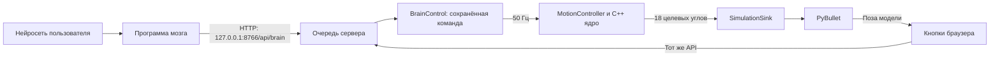

# Железная муха: управление и интеграция

Версия инструкции: 16 ноября 2026. [Пошаговая инструкция для первого запуска](FIRST_START.md).

## 1. Что реализовано

MotionController использует закреплённое C++ ядро Hexapod-Firmware: FK/IK,
походки Tripod/Wave/Ripple, протокол и автомат Robot. BrainControl переводит
намерения отдельной программы в свежие команды контроллера каждые 20 мс.

Работают расчёт 18 углов, симуляция PyBullet и кнопки в браузере. Нейросеть
в репозиторий не входит. Отдельная программа пользователя должна получать её
решение и переводить его в одну из разрешённых команд.

Целевая платформа — Repka Pi; модель и ОС пока не выбраны. Проверена Linux x86_64
с Python 3.14.10. Запуск на ARM/Repka и Windows/WSL отдельно на устройстве не проверен.
Аппаратный вывод на PCA9685/приводы, калибровка реальной механики и Fusion не реализованы.

## 2. Что с чем соединяется



Все процессы расположены на одном компьютере. Кабель между мозгом и алгоритмом
не нужен. `127.0.0.1` означает именно то устройство, на котором выполняется клиент.
В Windows для первого запуска держите и мозг, и сервер внутри одной Ubuntu в WSL;
браузер можно открыть в Windows. Адрес удалённого компьютера здесь не используется.

| Что подключить | Куда | Текущее состояние |
|---|---|---|
| Программу мозга | POST `/api/brain` | Работает через сервер симуляции |
| Браузер | `http://127.0.0.1:8766` | Работает |
| Собственный цикл расчёта | `src/brain_control.py` и `src/motion.py` | Работает без PyBullet |
| Плату приводов | Будущий аппаратный выход | Не реализован |
| Реальные сервоприводы | Будущий драйвер и калибровка | Не подключать по демонстрационному YAML |

## 3. Установка и запуск симуляции

Нужны Git, Bash, g++ с C++17, Python с venv и pip. Установка Linux/WSL и доступ
к приватному репозиторию подробно описаны в [инструкции новичку](FIRST_START.md).

Из каталога, где будет храниться проект:

```bash
git clone https://github.com/IvanTarKon/iron-fly.git
cd iron-fly
bash scripts/bootstrap.sh
python3 -m venv .venv
.venv/bin/python -m pip install -r requirements.txt
bash scripts/build.sh
.venv/bin/python scripts/simulation_ui.py --port 8766
```

Bootstrap восстанавливает upstream-компоненты по фиксированным SHA и применяет
сохранённый патч. Не обновляйте подмодули до последних версий. `build.sh` собирает
библиотеку под текущую архитектуру: x86_64-файл `.so` нельзя переносить на ARM.

Откройте `http://127.0.0.1:8766`. Сервер работает, пока открыт его процесс.
Ctrl+C завершает его. Для Linux с пользовательским systemd есть альтернативный запуск:

```bash
bash scripts/server.sh start
bash scripts/server.sh status
bash scripts/server.sh logs
bash scripts/server.sh stop
```

Не запускайте оба варианта одновременно на одном порту. Служба не настроена
на автозапуск после перезагрузки. `restart` обновляет уже запущенную службу;
при отсутствии службы используйте `start`.

## 4. Управление кнопками

В панели «Управление роботом» направление включается одним нажатием и сохраняется.
«Налево» и «Направо» поворачивают на месте, а не двигают боком.
«Стоп» завершает ходьбу со штатным сглаживанием и сохраняет стойку.

Кнопка «Ускорение ×1,5» включает постоянный множитель линейной скорости.
«Обычная ×1» отключает его. Ускорение сохраняется при смене направления и после
stop. Оно не меняет скорость поворота и не запускает движение из стойки.

По умолчанию линейная скорость 100 мм/с, ускоренная — 150 мм/с; поворот 15°/с.
Для изменения скорости кнопок/мозга перезапустите сервер с параметрами:

```bash
.venv/bin/python scripts/simulation_ui.py --port 8766 --brain-speed 0.1 --brain-turn-rate 15
```

`--brain-speed` — м/с, допустимо 0 < speed ≤ 0.2, чтобы ×1,5 оставалось в лимите
0.3 м/с. `--brain-turn-rate` — градусы/с, допустимо 0 < rate ≤ 60.
Это командные скорости, не гарантия фактической скорости корпуса или устойчивости.

Поля справа — другой, ручной режим. Чтобы использовать их: нажмите обычную кнопку
«Стоп» под панелью, введите параметры, нажмите «Применить параметры», затем
«Движение по параметрам». В нём разрешены также боковые движения. Поля справа
не изменяют скорость стрелок/мозга. Походку меняйте после остановки, в ручном режиме.

«Пауза физики» замораживает симуляцию. Это не stop. «Новая сцена» сбрасывает модель,
время и режим ускорения. При ошибке появляется кнопка «Разрешить после ошибки»;
сначала устраните причину, затем разрешите и заново выберите направление.

## 5. HTTP-протокол программы мозга

Отправляйте JSON UTF-8, только поле `command`:

```http
POST /api/brain
Content-Type: application/json
X-Muha-UI: 1

{"command":"forward"}
```

| command | Значение | Что сохраняется |
|---|---|---|
| `forward` | Вперёд по +X корпуса | До следующего направления/stop |
| `backward` | Назад по −X корпуса | До следующего направления/stop |
| `left` | Поворот налево, +yaw | До следующего направления/stop |
| `right` | Поворот направо, −yaw | До следующего направления/stop |
| `stop` | Остановка в стойке | Множитель остаётся прежним |
| `jump` | Ускорение ×1,5 | До normal или сброса сцены |
| `normal` | Обычная скорость ×1 | Направление не меняется |
| `start` | Разрешение после ошибки | Направление сбрасывается в stop |

Первая команда направления автоматически разрешает движение и ждёт готовности
стойки. После ошибки автоматического разрешения нет: нужен `start`, затем направление.
`jump` — условное имя ускорения, физического прыжка нет.

Пример из второго терминала, открытого в корне проекта:

```bash
python3 scripts/brain_client.py forward
python3 scripts/brain_client.py jump
python3 scripts/brain_client.py normal
python3 scripts/brain_client.py stop
```

Готовый пример отдельного процесса: `python3 examples/brain_sender.py`.
Он включает движение, затем ускорение и отправляет stop в блоке finally.
Сервер должен быть запущен заранее. При недоступном сервере finally не гарантирует
доставку stop; это ограничение связи, а не подтверждённая остановка.

Для интеграции скопируйте `scripts/brain_client.py` рядом со своей программой:

```python
from brain_client import send_command

# Здесь ваша нейросеть и преобразование её ответа в разрешённое слово.
command = 'forward'
send_command(command)
# Когда принято решение остановиться:
send_command('stop')
```

Не передавайте в API свободный текст нейросети: преобразуйте ответ в одно из
слов таблицы. Сервер не интерпретирует естественный язык. Повторять направление
50 раз в секунду не требуется: это делает адаптер. Достаточно посылать изменения.

HTTP 202 и `{"accepted":true}` означают принятие в очередь, не успешное движение.
HTTP 400 — неверная команда/JSON/размер либо переполненная очередь. HTTP 403 —
нет нужного заголовка или запрещён Origin. HTTP 404 — неверный путь.
Очередь содержит до 32 запросов, тело до 8192 байт. Доставки «ровно один раз»,
идентификаторов команд и отдельного подтверждения исполнения пока нет.

GET `/api/state` возвращает текущий снимок. Полезные поля:

| Поле | Смысл |
|---|---|
| `ready` | Сервер подготовил модель |
| `brain.active` | Командами владеет кнопочная/мозговая логика |
| `brain.command`, `brain.boost` | Направление и ускорение |
| `brain.blocked`, `brain.error` | Блокировка и причина |
| `output.state` | OFF, SETUP, IDLE, WALK, SHUTDOWN или FAULT |
| `output.armed`, `output.valid` | Разрешение и допустимость выходных углов |
| `output.angles` | 18 целевых углов в радианах |
| `position`, `pose` | Измеренная поза модели в PyBullet |

При `ready=false` остальные поля могут отсутствовать; при ошибке запуска может
прийти поле `error`. Проверяйте ответ перед чтением вложенных полей.

## 6. Владение командами и остановки

Кнопочная панель и программа мозга используют одну очередь и одно сохранённое
намерение. Последняя обработанная команда соответствующего вида побеждает.
Для испытания нейросети не нажимайте направления в браузере одновременно.

Старые действия start/move/stop/pause/reset через `/api/command` возвращают ручное
управление. Новая команда `/api/brain` возвращает управление мозгу. Простое наблюдение
и heartbeat страницы не перехватывают команды.

В мозговом режиме исчезновение клиента или закрытие страницы **не останавливает**
движение. Ошибка валидируемого brain-запроса либо переполнение очереди вызывает
блокировку на следующем рабочем такте. Ошибки происхождения запроса/заголовка
отбрасываются до этого механизма. Сбой ядра также блокирует движение.
В ручном режиме отсутствие heartbeat страницы более 2 с снимает движение.

MotionController по-прежнему отклоняет команды старше 0.5 с. BrainControl создаёт
новую низкоуровневую команду каждый такт, поэтому сохранённое намерение не стареет.
Если сам процесс завис, программный тайм-аут не заменяет аппаратную защиту.

## 7. Алгоритм без симуляции: подготовка Repka

Это расчёт целей суставов в локальной библиотеке, без физики, HTTP и моторов.
Готовый HTTP-вход пока размещён в `simulation_ui.py` и запускает PyBullet;
запуск без браузера не отключает физику. Отдельного аппаратного HTTP-сервиса пока нет.

После клонирования и bootstrap на целевой Linux-системе:

```bash
python3 -m venv .venv
.venv/bin/python -m pip install PyYAML==6.0.3
bash scripts/build.sh
.venv/bin/python scripts/verify_sources.py
.venv/bin/python tests/test_motion.py
.venv/bin/python tests/test_brain_control.py
.venv/bin/python examples/controller_only.py --seconds 10
```

Минимальный пример не импортирует PyBullet или NumPy. В нём печатаются состояние
и 18 углов раз в секунду, а цикл обновляется на 50 Гц. Последние две секунды он
подаёт stop, затем завершается. Это проверяемый пример интеграции, не демон управления
реальным роботом. Внутри используется in-process C++ firmware через SimTransport.

Для встраивания следуйте примеру: одним потоком вызывайте `brain.accept()` при
изменении намерения, затем `brain.next_command()`, `controller.update_motion(..., 0.02)`
и `brain.observe()` каждый такт. Из другого потока передавайте намерения через очередь;
не вызывайте методы контроллера параллельно. Обработку задержек планировщика и
аппаратную остановку для реального устройства предстоит спроектировать отдельно.

Вход MotionController: метры, радианы и логическое время `controller.time`.
Выход: LF/LM/LR/RF/RM/RR, в каждой ноге coxa/femur/tibia. Преобразование к servo-space
выполняет `to_servo_degrees(angles, config)`, включая порядок, знаки и trim. Это
всё ещё углы, не PWM-импульсы и не готовая распиновка.

Для Repka сначала нужны точные модель платы, версия ОС, архитектура и Python:

```bash
uname -m
cat /etc/os-release
python3 --version
```

На ARM библиотеку надо собирать на самой плате; соответствие Python/пакетов нужно
подтвердить там. Для Debian/Ubuntu-подобной системы нужны пакеты git, g++, python3,
python3-venv и python3-pip. Для иной ОС используйте её пакетный менеджер.
Не считать приведённые команды подтверждением совместимости неизвестной платы.

## 8. Что ещё нужно для настоящих приводов

Перед аппаратной интеграцией надо определить плату приводов, модель и питание
сервоприводов, реальные размеры ног, нулевые положения, знаки и механические пределы.
Далее потребуется драйвер выдачи команд, проверка порядка всех 18 каналов,
калибровка и аппаратная остановка. Номеров GPIO/I²C, напряжений и схемы проводов в
этой версии инструкции нет: оборудование не определено и драйвер не реализован.
Изменение `serial` в demo.yml не подключает моторы — MotionController его не использует.

## 9. Проверки и ресурсы

```bash
.venv/bin/python tests/test_motion.py
.venv/bin/python tests/test_brain_control.py
.venv/bin/python tests/test_simulation_ui.py
bash scripts/check.sh --demo-only
```

Первые два набора проверяют контроллер и намерения. Третий требует PyBullet и
локальных сокетов. Последняя команда запускает также физическую матрицу и upstream.
Известные 25 исходных upstream-сбоев показываются отдельно; строгий `check.sh`
может завершаться ненулевым кодом. Demo-only не означает полной приёмки ядра.

На Ryzen 5 8400F/Python 3.14.10 в коротком замере без физики: пик RSS 18.3 МиБ,
около 1.05–1.09% одного ядра, средний расчёт такта 0.19–0.21 мс из 20 мс.
Это не замер Repka, нейросети, HTTP или драйвера приводов. Четыре режима измерялись
по 4 секунды; использовать цифры как ориентир, а не аппаратную гарантию.

[Быстрый старт](FIRST_START.md) · [Краткий API](../BRAIN_API.md) · [Источники и лицензии](../THIRD_PARTY.md)
